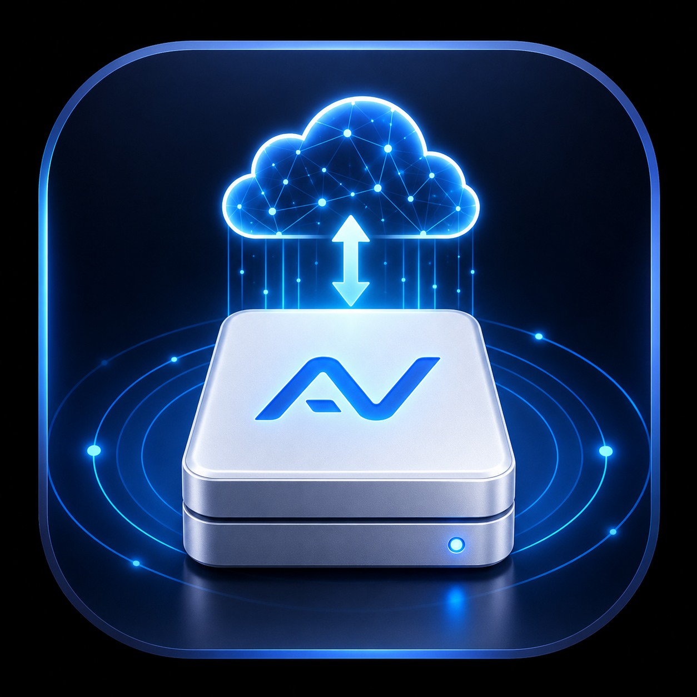

<div align="center">



# NetDiskMount

**A tiny menu bar app that keeps your NAS, network drives and external disks always mounted on your Mac**

After a network drop, sleep, or a Wi‑Fi switch, NetDiskMount reconnects your network folders automatically. External NTFS drives are read/write as soon as you plug them in.

> Starting with 1.0 the app is officially named **NetDiskMount** (formerly AutoVolume, a name that was often mistaken for a volume-control tool). Installed copies upgrade in place through the built-in updater and keep their settings and passwords.

[](https://github.com/mengyuefeitian/AutoVolume/releases/latest)


[](https://www.xiaoanhome.xyz/autovolume)
[](LICENSE)

[中文](README.md) | English

</div>

---

## ✨ What it does

Tired of your NAS folders disconnecting every morning? Re-typing WebDAV addresses and passwords? Plugging in a Windows drive and finding it read-only?

NetDiskMount lives in your menu bar and takes care of all that:

- 🔁 **Automatic reconnect**: when the network comes back or your Mac wakes up, network folders are mounted again, with no more "Connect to Server" in Finder.
- 🗂 **Set up once**: save the server, account, password and mount location once, and it just works from then on.
- 💽 **NTFS read/write**: external NTFS drives are mounted read/write automatically (asks for your Mac password once).
- 🔄 **Automatic updates**: checks for new versions daily; one click installs and relaunches.
- 🌏 **Languages**: System / 中文 / English / 한국어 / 日本語 / Русский, and switching is instant.
- 🩺 **One-click diagnostics**: export a diagnostics zip (no passwords) to report problems.

## 📦 Supported connections

| Type | Typical use | Example |
|---|---|---|
| **SMB** | Synology / QNAP NAS, Windows shares, router USB drives | `nas.local` + `share/tools` |
| **WebDAV** | Synology WebDAV, cloud drives with WebDAV | `https://example.com:5006` + `/` |
| **AFP** | Older NAS / Time Capsule | `nas.local` + `share` |
| **NFS** | Linux servers, NAS NFS exports | `nas.local` + `/exports/media` |
| **NTFS drives** | Windows-formatted USB sticks / external disks | Just plug it in |

SMB negotiates SMB2–SMB3 (insecure SMB1 is never used) with optional SMB3 multichannel, and you can mount a subfolder inside a share directly, e.g. `smb://nas.local/share/tools`.

## 📥 Install

1. Download the latest installer from [Releases](https://github.com/mengyuefeitian/AutoVolume/releases/latest): `NetDiskMount-x.y.z-arm64.dmg` for Apple silicon, `NetDiskMount-x.y.z-x86_64.dmg` for Intel.
2. Open the DMG and drag **NetDiskMount** into Applications.
3. Launch NetDiskMount from Applications. Its icon appears in the menu bar.

> **macOS blocks the first launch?** NetDiskMount is not notarized yet. Open System Settings → Privacy & Security and click "Open Anyway" near the bottom.

> **Upgrading from AutoVolume**: 0.1.53 and later are offered NetDiskMount 1.0 automatically; just click Install Update. After an in-app upgrade the folder in Applications is still called AutoVolume, but the app, menu bar and every window are NetDiskMount and nothing else is affected. For the file name to change too, install fresh from the DMG (settings and passwords are kept). 0.1.52 and earlier need one manual install of 0.1.53 or later first.

**Requirements**: macOS 14 Sonoma or later, on Apple silicon (M1 or newer) or Intel (Intel builds stop at macOS 26 Tahoe).

## 🚀 How to use

1. **Add a network folder**: click the menu bar icon → "Add" → choose SMB / WebDAV / AFP / NFS, fill in server, path, account and password → "Test Reachability" → "Save & Mount".
2. **That's it**: NetDiskMount checks at the interval you set and remounts anything that dropped. From the list you can mount, unmount, edit or remove at any time.
3. **NTFS read/write**: right-click the menu bar icon → Settings → NTFS, turn on "Automatically mount external NTFS drives read-write", then plug in your drive.
4. **Right-click menu**: View Logs, Export Diagnostics…, Settings, Check for Updates…, Quit.
5. **Settings**:
   - General: language, log level, open in Finder after a successful reconnect.
   - NTFS: the read/write toggle.
   - About: version, GitHub, website, Check for Updates.

## ❓ FAQ

<details>
<summary><b>I can't see the NetDiskMount icon in the menu bar</b></summary>

- Make sure you're on **0.1.53 or later**. Earlier versions don't start on macOS 14/15.
- On MacBooks with a notch, a crowded menu bar can hide icons. ⌘-drag other icons away, or use a menu bar manager such as Ice or Bartender.

</details>

<details>
<summary><b>WebDAV fails with 401 / 403 / 404</b></summary>

- **401**: wrong account or password.
- **403**: the account can't access that path.
- **404**: the remote path is wrong; use `/` for the root.

</details>

<details>
<summary><b>Why does NTFS read/write ask for my Mac password?</b></summary>

Writing to NTFS needs a small driver (based on open-source ntfs-3g and FUSE-T, with no kernel extension and no Recovery Mode). Installing it needs administrator permission, so you're asked once at first use and once after each NetDiskMount update.

</details>

<details>
<summary><b>NFS fails with "Permission denied"</b></summary>

- **Use the server's full export path**: on Synology that is `/volume1/<shared folder>`, for example `/volume1/video`; `video` alone does not work (if you enter only a share name, the app looks the full path up on the server and corrects it).
- **This Mac's IP must be in the share's NFS permissions** (DSM: Control Panel → Shared Folder → Edit → NFS Permissions).
- **Enable "Allow connections from non-privileged ports"**: the app mounts as a normal user and cannot use a reserved port (`resvport` is root-only).
- Keep the mount point inside your own folder (for example `~/Volumes/video`); `/Volumes` belongs to the system and apps cannot create folders there.

</details>

<details>
<summary><b>How do I report a problem?</b></summary>

Right-click the menu bar icon → "Export Diagnostics…". A zip appears on your Desktop. Open an [issue](https://github.com/mengyuefeitian/AutoVolume/issues), describe the problem and attach the zip. It **never contains passwords**, and account names are hidden.

</details>

<details>
<summary><b>How do I uninstall?</b></summary>

Right-click the menu bar icon → Quit, then move NetDiskMount from Applications to the Trash. To remove your settings, delete `~/Library/Application Support/AutoVolume`.

If you enabled NTFS read/write, remove the NTFS components in Terminal (asks for your password):

```bash
sudo launchctl bootout system /Library/LaunchDaemons/com.autovolume.ntfshelper.plist
sudo rm -f /Library/LaunchDaemons/com.autovolume.ntfshelper.plist /Library/PrivilegedHelperTools/com.autovolume.ntfshelper /etc/newsyslog.d/com.autovolume.ntfshelper.conf
sudo rm -rf /Library/PrivilegedHelperTools/com.autovolume.ntfsdriver
```

FUSE-T is installed separately; see the [FUSE-T website](https://www.fuse-t.org) to remove it.

</details>

## 🔒 Privacy & security

- No data is collected or uploaded. Servers, accounts and passwords stay on your Mac.
- Passwords are stored in a local encrypted file and never written to logs; logs and diagnostics are redacted automatically.
- Updates are downloaded from GitHub and verified with an EdDSA signature, so tampered updates are rejected.

## 🛠 Build from source

```bash
git clone https://github.com/mengyuefeitian/AutoVolume.git
cd AutoVolume/AutoVolume
./script/build_and_run.sh --verify     # build, run tests, sign
./script/package_dmg.sh 1.0.0          # package a DMG (must match Info.plist version)
```

See [`AutoVolume/CLAUDE.md`](AutoVolume/CLAUDE.md) for build-environment notes and the release workflow.

## 📝 Changelog

See [Releases](https://github.com/mengyuefeitian/AutoVolume/releases) for what changed in each version.

## 🙏 Credits

- [Sparkle](https://sparkle-project.org): software update framework (MIT)
- [ntfs-3g](https://github.com/macos-fuse-t/ntfs-3g): NTFS read/write driver (GPLv2)
- [FUSE-T](https://www.fuse-t.org): kext-less FUSE implementation (free for non-commercial use)

## 📄 License

NetDiskMount is released under the [MIT License](LICENSE). Bundled third-party components are covered by their own licenses, which ship with the app.
